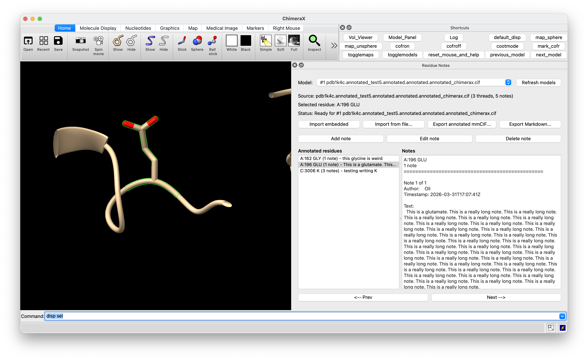

# ChimeraX Residue Notes

Version **0.2.6** reads, browses, edits, and exports residue, region, and
positional notes using the mmCIF annotation format shared with
[Coot Trimmings](https://github.com/olibclarke/coot1-trimmings/).

- Create notes from selected residues or a contiguous region, with optional
  endpoint picking and temporary graphical markers.
- Annotate unknown densities or binding sites at the current center of rotation.
- Browse nearby notes and select ranges without changing structure colours.
- Navigate with symmetric clipping, a 10 A minimum slab, and the existing CoFR mode.
- Export annotated mmCIF or Markdown, retaining compatibility with older notes.

## Install
Download or clone this repository, then install the **nested bundle folder**
from ChimeraX:

```chimerax
devel install "/path/to/chimerax-resnotes/chimerax-residue-notes"
```

Open the editor with `resnotes` or the nearby browser with `nearby_notes`.
Export remains explicit; ordinary ChimeraX model saving is not modified.

See the [bundle documentation](chimerax-residue-notes/README.md) for selection,
range picking, positional notes, file format, commands, and developer checks.
The bundle uses ChimeraX's own APIs; no separate Gemmi installation is required
to use it.

## Example

An [annotated example model](annotated_example.cif) and an earlier screenshot
are included:



This is a lightweight working tool with limited model coverage. Please report
issues with steps to reproduce. Developed with assistance from Codex.

Licensed under the [MIT license](license.txt). Maintainer: Oliver Clarke
(olibclarke@gmail.com). See the [Tool Shed preparation notes](chimerax-residue-notes/SUBMISSION.md)
for build instructions and test coverage. Native checks have passed on macOS
with ChimeraX 1.12.dev202603110023; stable 1.11 and Windows/Linux remain untested.
This GitHub update does not constitute a Tool Shed submission.
